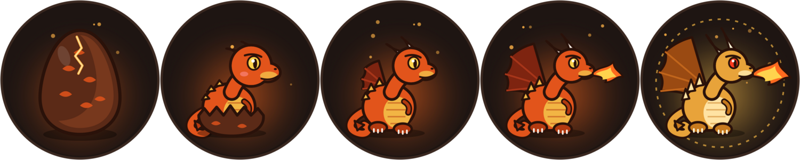

# 🐉 DragonFit

**Application iPhone de suivi nutritionnel et de musculation, gamifiée autour d'un dragon compagnon qui grandit avec ta régularité.**



> Projet personnel développé en React Native / Expo, avec l'aide de Claude (Anthropic) comme assistant de développement.

---

## ✨ Fonctionnalités

### 🍖 Festin : suivi nutritionnel
- Objectif calorique personnalisé : métabolisme de base (**Mifflin-St Jeor**), activité quotidienne, objectif perte / maintien / prise de masse
- Répartition des macros : protéines 2 g/kg, lipides 25 %, glucides le reste
- Ajout d'aliments par **recherche** ou **scan de code-barres** via l'API **Open Food Facts**, ou par saisie manuelle
- **Favoris**, aliments récents et **repas enregistrés** ajoutables en un clic

### ⚔️ Entraînement
- **Chrono de séance** persistant (il continue même si l'appli est fermée)
- Calcul des calories dépensées avec les **METs** du *Compendium of Physical Activities* : `(MET − 1) × poids × durée`, sans double comptage du métabolisme de repos
- Journal des séries (répétitions × charge), exercices récents, record personnel

### 📜 Chroniques
- Graphiques des calories sur 7 jours par rapport à l'objectif
- Progression de la charge maximale par exercice
- Historique des séances

### 🐉 Dragon compagnon
Le dragon gagne de l'XP avec la régularité (repas notés, objectif respecté à ±10 %, séances, séries) et évolue en 5 stades : **Œuf → Dragonnet → Jeune dragon → Dragon → Dragon ancien**. Les illustrations sont originales et générées en SVG.

---

## 🛠️ Stack technique

| | |
|---|---|
| Framework | React Native 0.88 · Expo SDK 58 |
| Langage | TypeScript |
| Données | AsyncStorage (tout est stocké sur l'appareil, sans serveur) |
| API | Open Food Facts |
| Natif | expo-camera (scan de codes-barres) |

Les graphiques sont faits sans librairie, à partir de simples `View` React Native.

## 📁 Architecture

```
App.tsx                    Navigation par onglets
src/
  ui.tsx                   Design system (couleurs du thème Dragon, composants)
  lib/
    types.ts               Modèle de données
    nutrition.ts           Calculs : BMR, TDEE, macros, METs
    dragon.ts              Système d'XP et stades du dragon
    openfoodfacts.ts       Client de l'API Open Food Facts
    store.tsx              État global (Context) + persistance locale
  screens/                 Écrans de l'application
```

## 🚀 Lancer le projet

```bash
npm install
npx expo start
```
Scanne ensuite le QR code avec l'appareil photo de l'iPhone. Il faut l'appli **Expo Go** et un compte Expo connecté sur le PC et sur le téléphone.

## 🗺️ Feuille de route

- [ ] Analyse d'une photo de repas avec l'API Claude
- [ ] Synchronisation Apple Santé
- [ ] Graphique d'évolution du poids
- [ ] Distribution via TestFlight
- [ ] Tests unitaires des calculs nutritionnels

## 🤖 Méthode de travail avec l'IA

Ce projet a été développé en binôme avec Claude. Mon rôle : définir les besoins et les fonctionnalités, faire les choix produit (thème, gamification, règles d'XP), tester sur l'appareil et valider chaque étape.

<!-- À personnaliser : ajoute ici un exemple concret de décision que tu as prise, ou d'un bug que tu as repéré et fait corriger. -->
